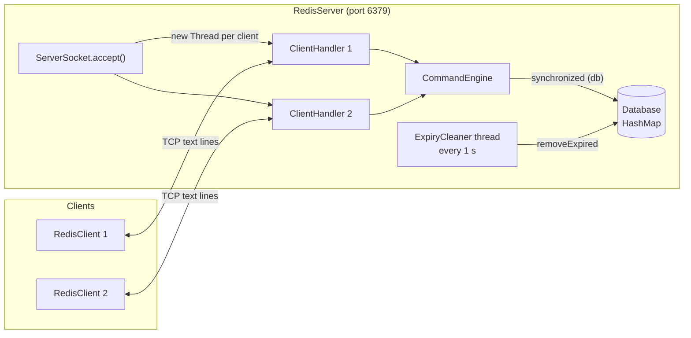
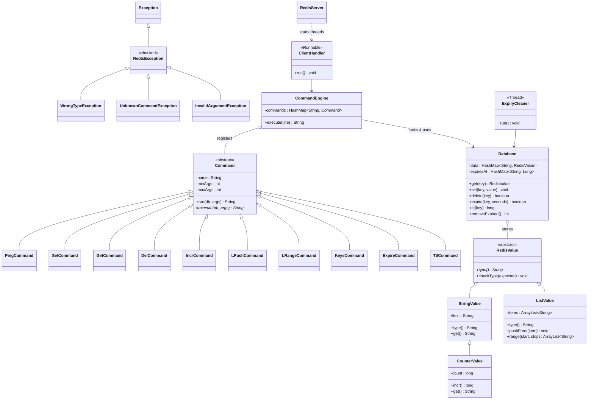
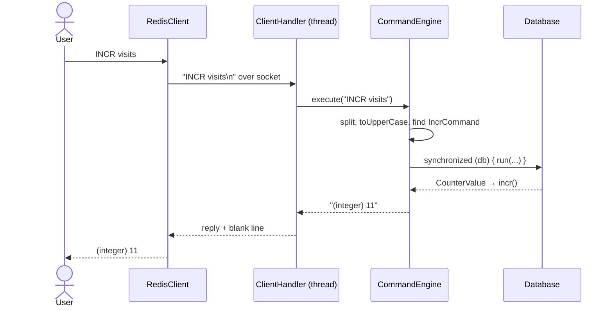

# MiniRedis

A small Redis-like **in-memory key-value database** written in Java, built as a case study for the Object Oriented Programming Lab.

It runs as a TCP server on port **6379** (the same port as real Redis). Several clients can connect at once, each served by its own thread, and all of them share one database.

```
127.0.0.1:6379> SET name Aveek
OK
127.0.0.1:6379> INCR visits
(integer) 1
127.0.0.1:6379> LPUSH tasks study code sleep
(integer) 3
127.0.0.1:6379> LRANGE tasks 0 -1
1) "sleep"
2) "code"
3) "study"
127.0.0.1:6379> INCR name
(error) ERR value is not an integer or out of range
```

## Architecture



## Class diagram



## What happens when you type a command



## Commands

| Command | Example | Reply |
|---|---|---|
| `PING [msg]` | `PING` | `PONG` |
| `SET key value` | `SET name Aveek` | `OK` |
| `GET key` | `GET name` | `"Aveek"` or `(nil)` |
| `DEL key [key ...]` | `DEL name tasks` | `(integer) 2` |
| `INCR key` | `INCR visits` | `(integer) 11` |
| `LPUSH key item [item ...]` | `LPUSH tasks study code` | `(integer) 2` |
| `LRANGE key start stop` | `LRANGE tasks 0 -1` | numbered list |
| `KEYS pattern` | `KEYS *`, `KEYS user*` | numbered list |
| `EXPIRE key seconds` | `EXPIRE otp 30` | `(integer) 1` |
| `TTL key` | `TTL otp` | seconds left, `-1` no expiry, `-2` missing |
| `QUIT` | `QUIT` | closes the connection |

## OOP concepts used

| Concept | Where |
|---|---|
| Abstraction + `final` method | `RedisValue.checkType()`, `Command.run()` |
| Three-level inheritance, `super`, `protected` | `RedisValue → StringValue → CounterValue` |
| Method overriding, superclass references | `CounterValue.get()`, `HashMap<String, Command>` holding every command |
| Custom checked exceptions, `throw`/`throws`, `finally` | `RedisException` family, `ClientHandler`, `RedisServer` |
| Strings and `StringBuffer` | parsing in `CommandEngine`, reply building in `Command.list()` |
| Arrays and `ArrayList` | `Arrays.sort` in `KeysCommand`, `ListValue` |
| Multithreading | thread per client, `ExpiryCleaner` daemon thread, `synchronized`, `join()` in `RaceDemo` |
| Networking | `ServerSocket` / `Socket` in `RedisServer` and `RedisClient` |

## Running it in BlueJ

1. **Project → Open Non BlueJ…** and open `MiniRedis-Server`. Run `RedisServer.main`.
2. Open `MiniRedis-Client` the same way (it gets its own terminal) and run `RedisClient.main`.
3. More clients can be started from a command prompt inside `MiniRedis-Client`:
   `"C:\Program Files\BlueJ\jdk\bin\java" -cp . RedisClient`
4. Stop the server with **Reset Java Virtual Machine**.

`RaceDemo.main` shows why synchronization matters: four threads each add 1 to a counter 100,000 times. Without a lock some updates are lost; through the synchronized engine the total is always exactly 400,000.

```
Expected total: 400000
Test 1 - without synchronization: 157551
Test 2 - with synchronization:    "400000"
```
